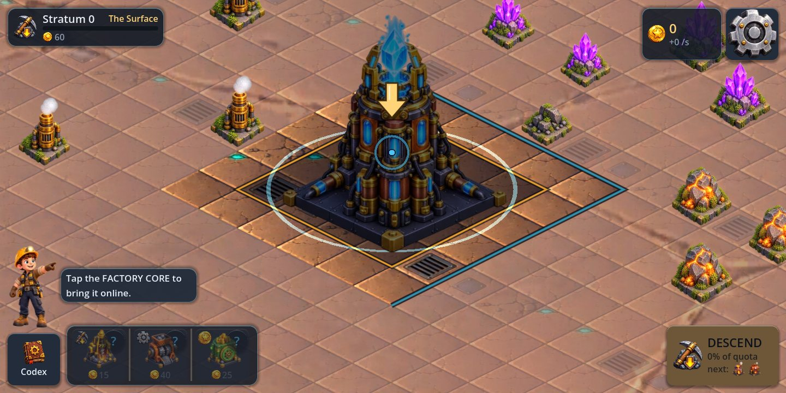
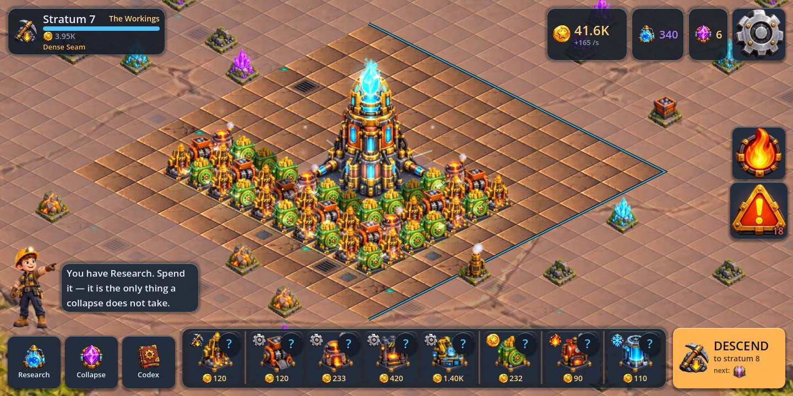
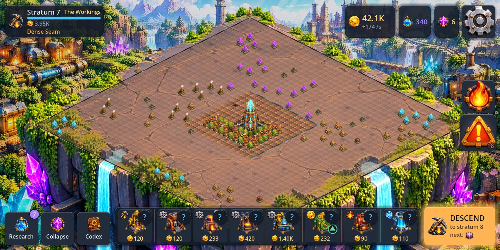
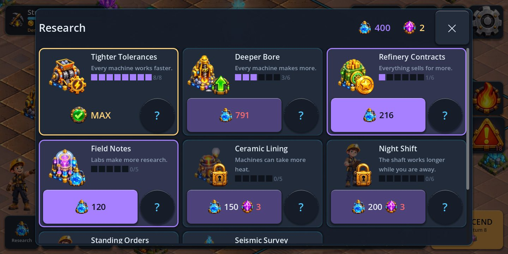
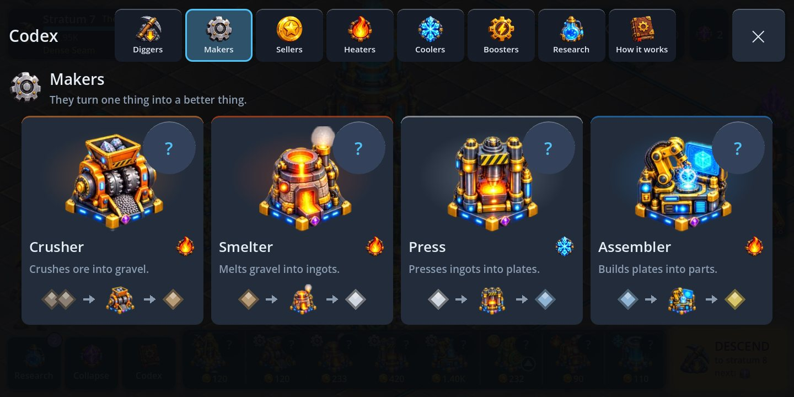

# Lodeworks

**An idle machine-grid builder for Android. Place machines, feed each other by
adjacency, manage heat, descend the strata.**

Not published. This repository is a working game, a test suite that checks the
*balance* and not only the code, and everything needed to put it on Google Play
except the things only a human with a bank account can do.







A landscape, three-quarter isometric world: a painted canyon with parallax, a
rock island floating in it, and on it a 44 x 44 board with the Factory Core
standing in the middle.

**A shaft starts small.** The Core is dark, and a tap brings it online and
pays for the first Drill and Vault. The one-tile ring round it is all the
ground there is to build on at first. Deeper strata widen the ring, and
the Core grows with it, until the whole board is open. The ground the
factory has not reached is strewn with crystals, ore and rubble, and the
growing yard clears them as it goes.

Drag to pan, pinch or wheel to zoom, tap to place, tap a machine to select
it and drag it to move it, or press the bin on its panel to remove it. The
simulation underneath is the one the tests below check; the screen only reads
it. ([docs/ART.md](docs/ART.md) is the visual system,
[docs/AUDIT.md](docs/AUDIT.md) section 0 what it was measured to cost.)

---

## Learning it

Nothing is explained that can be shown instead.

The first chapter is eight steps long, each one a single line and a pulsing
outline on the tiles where the answer is. It teaches placing, adjacency, the
first income, moving, refining, heat, the quota and the first descent — by
having you do them, in the real game, on your real board. Then it stops. There
are no further tutorial windows; new machines and new strata are for
discovering.

The Foreman -- a young miner at the edge of the screen, never over the
board -- says each line, and a yellow arrow bobs over the thing to tap. After
the chapter he goes quiet except for a new stratum and the first machine that
overheats in it.

Every panel shows before it tells: pictures first, a few words, and the full
sentence behind a **?** key. Research is a grid of cards, each with a picture
of what it acts on, its level and its price on the key that buys it.

| Research | Codex |
|---|---|
|  |  |

The **Codex** is there if you want it, one key at the bottom left. It is filed
by the same seven machine groups as the tray -- Diggers, Makers, Sellers,
Heaters, Coolers, Boosters, Research -- and shows each machine big and moving,
with one plain line and what goes in and comes out. Its "How it works" pages
each run a **small board that is actually running** — a real `Simulation`
with the same machines and the same status colours as the game. Put a Boiler
next to a Smelter on a Codex page and the Smelter's pip goes green and its
progress bar speeds up, because that is what happens. A help page that
describes a rule can be wrong; a help page that runs the rule cannot.

## What the board tells you

The single hardest thing in a factory game is finding out which machine is the
problem. The convention this board uses is the one Factorio players install a
third-party mod to get, because two of its colours point in **opposite
directions along the chain**:

| | |
|---|---|
| a machine breathing and lit | working |
| amber badge, two bars, on its output side | backed up — the problem is **downstream** |
| red badge, an empty ring, on its input side | missing an input — the problem is **upstream** |
| a warm glow, embers and a flame badge (or blue and frost) | the wrong temperature, and losing output for it |

Each state is a different glyph as well as a different colour, so the board
still works without colour vision. A badge only appears once a state has held
for a second and a half, and only on the machine where a jam starts -- not on
every machine queued behind it. The warning key counts what is wrong, swells
more insistently as the count grows (never flashing), and each tap glides the
camera to the next culprit. Tapping a machine opens its panel
where the machine tray was, below the board, and draws every connection in
and out of it on top of the world.

Tapping the Factory Core opens its card: its level, and the whole factory in
four numbers -- machines, how many are working, how many need help (the
warning key's own count, with a key that goes to the first one), and what
it earns -- with how much of the yard is built and what the next stratum
brings. Tapping a crystal, an ore vein or a heat vent round the yard says
what it is, what uses it, and when the yard will reach it. On a stratum
whose rules help or hold back a machine, its tray key carries a green or
red arrow -- the simulation's own answer for that machine on that rock --
and the stratum's card shows the same machines under each rule. Holding Descend (or
tapping it before the quota) shows the next stratum's rules, machines and
ground before you go. Settings has a
**Larger text** switch that makes every word a quarter bigger.

The heat button glows before it is pressed when some machine is too hot, or
shows frost when one is too cold. Pressed, it relabels every tile with how far
it is from the temperature it personally wants, as a signed number. Every machine in this game wants a
different temperature, so an absolute heat map answers the wrong question.

None of this was invented here. It came out of
[four sourced investigations](docs/research/) into what the genre's leaders
actually ship and what their players actually complain about.

## The loop

A 44 x 44 grid, opened ring by ring round the Core. Machines have inputs and outputs and feed **whatever is
orthogonally next to them** — there are no belts to draw, because drawing belts
on a phone is miserable. What makes it a puzzle instead of a packing exercise
is heat: every machine emits it, half of it bleeds into each neighbour, and
each machine has a temperature it wants to be at. A Smelter runs 15% faster
with a Boiler beside it. A Press three tiles from that Boiler chokes.

Then:

| timescale | what pulls you back |
|---|---|
| 10 seconds | move one tile, watch the credits-per-second change |
| 1 minute | the first drill → crusher → vault chain pays for the next drill |
| 10 minutes | the quota falls, you descend, the yard widens, the rock is richer and hotter |
| first session | the first strata take two or three minutes each, the middle ones three or four, and the first machine that only matters because of what it is next to arrives |
| next day | offline production banked while you were away |
| first week | the component chain, Labs, and the research tree |
| long term | collapse the shaft for Cores, which survive it with every upgrade you researched, and start again deeper and faster |

Every stratum is generated from its depth — the same stratum 14 for everybody,
no server involved — with up to two modifiers drawn from a table of twelve,
explained by a tap on the stratum card.
*Thermal Vent + Brittle Rock* is a different board from *Insulating Clay +
Resonant*, and the layout that was right for one is wrong for the other.

That is the production argument for this design: **one more modifier is one row
of data and a large multiple of gameplay.** A match-3 gets one more level.

## Why depth is worth it

It was not, and that was measured rather than suspected. Under the original
recipes every refining step consumed **two** of the thing below it, while a
machine is fed only by the four cells it touches — so the supply tree branched
faster than the space to attach it, and a chain deeper than three steps could
not be fed at all. The Press, Assembler, Lab and Condenser were content an
optimising player would never build.

Five economic models were written and run against seven board archetypes at
three depths ([`tools/econ_lab.gd`](tools/econ_lab.gd); all five are still in
the source). The one that shipped changes a rule, not a number: from the
Smelter upwards each step takes **one** of the thing below it, the value ladder
is flattened to match, and the deep machines run warm so a long chain has to
be cooled and the cooling costs tiles.

The result is deliberately close, not dominant:

| depth | best board | margin |
|---|---|---|
| 3 | a full chain | 328/s against shallow's 324/s |
| 9 | a full chain | 592/s against shallow's 588/s |
| 16 | raw ore | Cramped takes thirty tiles; no long chain fits |

Near parity on credits — and a monopoly on Research, because Research comes
from a Lab and a Lab only eats Components. So the question is not "which board
earns more" but "credits now, or upgrades that outlast the shaft", and the
stratum decides which board is even buildable.

## The art, and no audio files

The pictures are generated -- twelve machines in six palettes and two upgrade
tiers, the world, the island, the Core, props, HUD icons and the Foreman --
all against one isometric style sheet, and built into the game by
`tools/art_build.py`, which measures every sprite's base plate from its alpha
channel and writes `assets/art/layout.json`. Every file has its generation job,
prompt and references in [art_src/SOURCES.md](art_src/SOURCES.md). 6.76 MB
committed against a 40 MB budget (`tools/asset_budget.py`).

There is still not one sound file: every sound effect and the factory ambience
are synthesised from arithmetic at startup.

## Monetisation, designed in rather than bolted on

- **Rewarded video only. No interstitials, anywhere.** Every ad is opt-in and
  additive: double what you already earned while away, reroll a stratum you
  already reached. Nothing is taken away to be sold back.
- **One IAP.** "Foreman's Licence" — removes ads and adds 4 hours of offline
  banking. It unlocks no machine, no stratum, no upgrade. The whole game is
  reachable without it. It also carries 2 blueprint slots, which the shop
  does not advertise while blueprints have no screen.
- **Neither one can move an economy number**, and that is a test rather than a
  promise: the suite runs the same board licensed and unlicensed and requires
  identical output. If the ad SDK is missing, broken, or hangs mid-ad, the game
  keeps running and the player loses nothing but the ad.
- **No energy, no timers, no gacha, no subscription, no daily-login guilt.**

The revenue cost of skipping interstitials is real and it is on purpose. An
idle game someone keeps on their phone for months is worth more than one they
delete in week one.

## Running it

```bash
godot --path . --resolution 1440x720                              # play it
godot --headless --path . --script res://tests/test_runner.gd     # 289 tests
godot --headless --path . tools/layout_check.tscn                 # 11 screen shapes x 3 safe areas
godot --path . --resolution 1440x720 tools/perf_probe.tscn        # frame times, draw calls, memory
godot --headless --path . --script res://tools/selftest_cli.gd    # the device self test, minus the device
godot --headless --path . --script res://tools/diagnose.gd        # per-tile balance dump
godot --headless --path . --script res://tools/layout_lab.gd      # score the reference layouts
godot --headless --path . --script res://tools/layout_search.gd   # hill-climb for a better board
godot --headless --path . --script res://tools/econ_lab.gd        # compare economic models
GODOT=$(which godot) tools/store-assets.sh                        # regenerate every store asset
```

For a phone: the `android` workflow builds an installable APK on every push —
twice, once with the native plugins and once deliberately without them.
[docs/DEVICE-TEST.md](docs/DEVICE-TEST.md) is the procedure for getting it onto
a device and reading the numbers off.

Needs **Godot 4.7.2 or newer** — 4.5 is the floor for Google Play because
anything older targets an SDK Play no longer accepts (see
[docs/RELEASE.md](docs/RELEASE.md)).

## What the tests actually test

`tests/test_progression.gd` is the interesting one. It plays the game headless
at real tick rate and asserts against wall-clock seconds:

- the first quota falls inside a first session
- a well-connected eight-tile board beats a scattered ten-tile one
- heat management pays for itself **when heat is the bottleneck**, and does
  nothing when it is not — which is the lesson the game teaches, so it is
  asserted rather than papered over
- a complete ore → component → research chain fits on the board and runs
- the curve has not walled out by stratum 20

`tests/test_performance.gd` is the one that would have caught the fourth. It
asserts the tick budget, the save budget, that every picture ships from the
budgeted art folder and no audio file ships at all, and — after
[a measurement that said otherwise](docs/BALANCE.md) — that no more than a
third of the reference board is sitting idle.

`tests/test_monetization.gd` is the other one worth reading: it asserts that
ads and the purchase cannot touch credits, research or cores, that a bound but
broken ad SDK leaves the game fully playable, that a hand-edited entitlement
file cannot invent a product, and that the analytics vocabulary is exactly the
thirteen events that were decided on and not one more.

Seven real balance bugs were found by these and fixed: depth added no yield at
all (`richness` was computed and never applied), the late-game chain deadlocked
because multi-input machines could not be fed on a four-neighbour grid, the
throughput measurement window was short enough to rank two identical layouts
differently, and — found by the per-tile duty-cycle readout added for the
board to draw — **the reference layout the project had been showing off had
thirteen of its twenty-eight machines permanently stalled**. The replacement
earns nine times as much from the same tile count.
Then two more, both found by instruments built for something else — which is
the argument for building them. The **duty-cycle readout was measuring intent
rather than work**, reporting 99% for a machine completing barely half the
cycles its supply allowed, which made every dead-tile figure in the balance
tools wrong. And **a producer handed its entire output to whichever consumer
the cell dictionary visited first**, so one Crusher feeding three identical
Smelters produced duty cycles of 96%, 73% and 0% — three tiles, identically
connected, doing completely different amounts of work, with nothing on screen
that could explain it, because there was nothing to explain. Material now
moves by a round-robin push. Dead tiles on shallow boards fell from
twenty-one to zero.

And one in the headline number itself: the credits-per-second readout averages
over a three-second window and **kept publishing that window after the board
had changed**, so for three seconds after any placement — and right through a
collapse, on an empty board — it reported the rate of a factory that no longer
existed. It was found because a store screenshot of the six-machine starter
board was captured reading 600 credits a second against an actual 2.4.

[`docs/BALANCE.md`](docs/BALANCE.md) has every measurement.

## Layout

```
scripts/core/     Grid, Simulation, MachineDB, Strata, Economy — all RefCounted,
                  no nodes, so the whole game runs headless
scripts/sim/      the one autoload that owns live state
scripts/services/ save, analytics, ads, IAP, and the device self test — each
                  degrades to a no-op when its native plugin is absent, so the
                  game always runs and always tests
scripts/ui/iso/   the world: projection, camera, badges, art lookup, and
                  IsoView, which draws it and turns fingers into place / move /
                  sell / pan / zoom
scripts/ui/       the landscape HUD, Codex, shop, diagnostics
assets/art/       the generated art and layout.json; art_src/ its sources
tests/            289 tests, no framework dependency
tools/            store assets, balance scoring, layout search, the self test
                  CLI, the plugin installer and the Android build script
.github/          tests and screenshots on every push; the Android export runs
                  there because it is the only place with an Android SDK
store/            listing copy, icon, screenshots generated from the real game
docs/             design and release notes
```

## Honest status

Working: the simulation, the economy, the descent, prestige, the research tree,
saves with offline progress, the tutorial, the UI, and the ad/IAP/analytics
interfaces with their no-op fallbacks.

Everything that can be automated has been. What is left is a keystore and
a phone:

- **The build chain runs.** The private repository `Furkiozknn/lodeworks`
  builds, on every push, two debug APKs (one deliberately with no ad or
  billing SDK at all) and a debug-signed AAB, and checks the bytes of each.
  A signed release bundle needs three repository secrets and a tag;
  [`docs/CI.md`](docs/CI.md) is the procedure.
- **The export configuration is also checked without a build**:
  `tests/test_release_config.gd` checks both preset names against the
  workflow, targetSdk 36 and minSdk 24, APK/AAB parity, permissions, that no
  keystore material is committed, launcher icons, versions, and every file
  the workflows invoke.
- **The device pass is a twenty-minute scripted procedure**, not a wish.
  [`docs/DEVICE-TEST.md`](docs/DEVICE-TEST.md) has twenty-five checks with
  pass criteria; eighteen of them the game runs on itself in one tap and
  prints as a pasteable block, including a three-minute soak that compares
  the last thirty seconds of frame time against the first.

Not done, stated plainly because the alternative is a plausible number with
nothing behind it:

- **The game has never run on a phone.** Every performance, input, thermal and
  battery figure for real hardware is UNKNOWN. The self test measures all of
  them in one tap; nobody has tapped it.
- **No ad has ever been shown and no purchase has ever been made.** No AdMob
  account, no ad unit ids, no Play Console product. The integration is written
  and its failure paths are tested; the live paths are not, so monetization is
  not working.
- **No signed release build exists** (no keystore), so a release size is
  UNKNOWN; the debug APKs are 163-174 MB with x86_64 included and unstripped.
- **The store screenshots and preview video are the old portrait ones** and
  no longer show the game; the landscape capture is automated, choosing and
  uploading is not.
- No music, and blueprints save and load but have no UI, so the research
  line and the shop bullet that sell blueprint slots are hidden.

See [docs/RELEASE.md](docs/RELEASE.md) §6 for claim-by-claim evidence and §7
for what needs a human.

## Licence

Code: MIT (see LICENSE). The name "Lodeworks", the icon and the store copy are
not covered by it.
