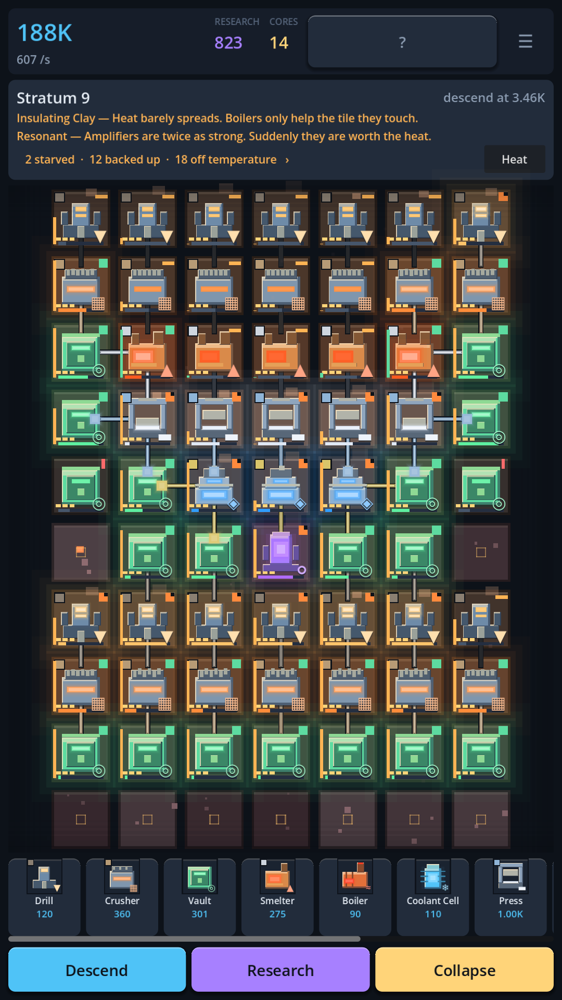

# Lodeworks

**An idle machine-grid builder for Android. Place machines, feed each other by
adjacency, manage heat, descend the strata.**

Not published. This repository is a working game, a test suite that checks the
*balance* and not only the code, and everything needed to put it on Google Play
except the things only a human with a bank account can do.



---

## Learning it

Nothing is explained that can be shown instead.

The first chapter is eight steps long, each one a single line and a pulsing
outline on the tiles where the answer is. It teaches placing, adjacency, the
first income, moving, refining, heat, the quota and the first descent — by
having you do them, in the real game, on your real board. Then it stops. There
are no further tutorial windows; new machines and new strata are for
discovering.

The **Codex** is there if you want it, behind a `?` in the header. Every page
is a title, one line of what to look at, two sentences, and a **two-to-five
tile board that is actually running** — a real `Simulation` with the same
tiles, the same status lights and the same heat wash as the game. Put a Boiler
next to a Smelter on a Codex page and the Smelter's pip goes green and its
progress bar speeds up, because that is what happens. A help page that
describes a rule can be wrong; a help page that runs the rule cannot.

## What the board tells you

The single hardest thing in a factory game is finding out which machine is the
problem. The convention this board uses is the one Factorio players install a
third-party mod to get, because two of its colours point in **opposite
directions along the chain**:

| | |
|---|---|
| green square | working |
| amber bar | output backed up — the problem is **downstream** |
| red bar | missing an input — the problem is **upstream** |
| orange or blue notch | running at the wrong temperature, and losing output for it |

Each state is a different shape as well as a different colour, so the board
still works without colour vision. One line above the grid counts what is
wrong; tapping it walks through the culprits. Tapping a machine opens a sheet
at the *bottom* of the screen — never a popover under the thumb that is
pointing at the tile — which says in words what is wrong and which way to
look.

The heat button relabels every tile with how far it is from the temperature it
personally wants, as a signed number. Every machine in this game wants a
different temperature, so an absolute heat map answers the wrong question.

None of this was invented here. It came out of
[four sourced investigations](docs/research/) into what the genre's leaders
actually ship and what their players actually complain about.

## The loop

A 7×10 grid. Machines have inputs and outputs and feed **whatever is
orthogonally next to them** — there are no belts to draw, because drawing belts
on a phone is miserable. What makes it a puzzle instead of a packing exercise
is heat: every machine emits it, half of it bleeds into each neighbour, and
each machine has a temperature it wants to be at. A Smelter runs 15% faster
with a Boiler beside it. A Press three tiles from that Boiler chokes.

Then:

| timescale | what pulls you back |
|---|---|
| 10 seconds | move one tile, watch the credits-per-second change |
| 1 minute | the first drill → crusher → vault chain pays for the next drill |
| 10 minutes | the quota falls, you descend, the rock is richer and hotter |
| first session | three or four strata, and the first machine that only matters because of what it is next to |
| next day | offline production banked while you were away |
| first week | the component chain, Labs, and the research tree |
| long term | collapse the shaft for Cores, which are the only thing that survives, and start again deeper and faster |

Every stratum is generated from its depth — the same stratum 14 for everybody,
no server involved — with up to two modifiers drawn from a table of twelve.
*Thermal Vent + Brittle Rock* is a different board from *Insulating Clay +
Resonant*, and the layout that was right for one is wrong for the other.

That is the production argument for this design: **one more modifier is one row
of data and a large multiple of gameplay.** A match-3 gets one more level.

## Heat that travels

Until stratum 3 heat is strictly local: a machine warms its own tile and half
of that bleeds one step. That makes the core tension sharp, because the Boiler
that a Smelter wants is the same Boiler that chokes the Press beside it. It
also makes some boards impossible, because there is no way to warm one tile
without warming everything round it.

The **Heat Pipe** (unlocks at stratum 3, alongside the Press) is the one
machine that moves heat instead of making or removing it. It hands each
neighbour the heat its *other* neighbours give it, at full strength, so the
two tiles on either side of a pipe behave as if they touched. A Boiler can
warm a Smelter two tiles away, and the Press can stand clear of both. Cold
travels the same way: a Coolant Cell on one side cools the tile on the other.

Three rules keep it readable, and each one has a test in `tests/test_grid.gd`:

- **One hop.** A pipe relays only what its neighbours emit, never what
  another pipe relays, so two pipes in a row are not a heat network. This is
  the same rule as material bridging.
- **No feedback.** A machine never gets its own heat back through a pipe.
- **Ambient once.** The stratum warms every tile once, after the relay.

Like every support tile, material passes straight through it. Because the pipe
emits nothing, the placement preview could no longer be "heat out × spread".
It now comes from `Grid.heat_contribution()`, which rebuilds the field with and
without the machine. The number under your finger is therefore the board's own
rule, including tiles two steps away. The Codex has a running page for it.
Factorio's heat pipes (Space Age) and Oxygen Not Included's conductive tiles
are the genre references. Here it is deliberately one tile and one hop, so the
board stays something you can read at a glance.

## Why depth is worth it

It was not, and that was measured rather than suspected. Under the original
recipes every refining step consumed **two** of the thing below it, while a
machine is fed only by the four cells it touches — so the supply tree branched
faster than the space to attach it, and a chain deeper than three steps could
not be fed at all. The Press, Assembler, Lab and Condenser were content an
optimising player would never build.

Five economic models were written and run against seven board archetypes at
three depths ([`tools/econ_lab.gd`](tools/econ_lab.gd); all five are still in
the source). The one that shipped changes a rule, not a number: from the
Smelter upwards each step takes **one** of the thing below it, the value ladder
is flattened to match, and the deep machines run warm so a long chain has to
be cooled and the cooling costs tiles.

The result is deliberately close, not dominant:

| depth | best board | margin |
|---|---|---|
| 3 | a full chain | 328/s against shallow's 324/s |
| 9 | a full chain | 592/s against shallow's 588/s |
| 16 | raw ore | Cramped takes thirty tiles; no long chain fits |

Near parity on credits — and a monopoly on Research, because Research comes
from a Lab and a Lab only eats Components. So the question is not "which board
earns more" but "credits now, or upgrades that outlast the shaft", and the
stratum decides which board is even buildable.

## No art files, no audio files

There is not one bitmap and not one sound file in this project. The board, the
UI, the app icon and the feature graphic are all drawn by the same code; every
sound effect and the factory ambience are synthesised from arithmetic at
startup, a few milliseconds of sine partials and filtered noise.

That is a production decision before it is an aesthetic one. A solo developer's
scarcest resource is art, and the second scarcest is the patience to keep
twelve machines looking like each other. Here a new machine is a row in a
table, a colour and a silhouette family — and the store artwork picks it up
without anyone exporting anything. It also means there is no licence to check
and nothing to clear before shipping.

## Monetisation, designed in rather than bolted on

- **Rewarded video only. No interstitials, anywhere.** Every ad is opt-in and
  additive: double what you already earned while away, reroll a stratum you
  already reached. Nothing is taken away to be sold back.
- **One IAP.** "Foreman's Licence" — removes ads, +4 hours of offline banking,
  +2 blueprint slots. It unlocks no machine, no stratum, no upgrade. The whole
  game is reachable without it.
- **Neither one can move an economy number**, and that is a test rather than a
  promise: the suite runs the same board licensed and unlicensed and requires
  identical output. If the ad SDK is missing, broken, or hangs mid-ad, the game
  keeps running and the player loses nothing but the ad.
- **No energy, no timers, no gacha, no subscription, no daily-login guilt.**

The revenue cost of skipping interstitials is real and it is on purpose. An
idle game someone keeps on their phone for months is worth more than one they
delete in week one.

## Running it

```bash
godot --path . --resolution 720x1440                              # play it
godot --headless --path . --script res://tests/test_runner.gd     # 137 tests
godot --headless --path . --script res://tools/selftest_cli.gd    # the device self test, minus the device
godot --headless --path . --script res://tools/diagnose.gd        # per-tile balance dump
godot --headless --path . --script res://tools/layout_lab.gd      # score the reference layouts
godot --headless --path . --script res://tools/layout_search.gd   # hill-climb for a better board
godot --headless --path . --script res://tools/econ_lab.gd        # compare economic models
GODOT=$(which godot) tools/store-assets.sh                        # regenerate every store asset
```

For a phone: the `android` workflow builds an installable APK on every push —
twice, once with the native plugins and once deliberately without them.
[docs/DEVICE-TEST.md](docs/DEVICE-TEST.md) is the procedure for getting it onto
a device and reading the numbers off.

Needs **Godot 4.7.2 or newer** — 4.5 is the floor for Google Play because
anything older targets an SDK Play no longer accepts (see
[docs/RELEASE.md](docs/RELEASE.md)).

## What the tests actually test

`tests/test_progression.gd` is the interesting one. It plays the game headless
at real tick rate and asserts against wall-clock seconds:

- the first quota falls inside a first session
- a well-connected eight-tile board beats a scattered ten-tile one
- heat management pays for itself **when heat is the bottleneck**, and does
  nothing when it is not — which is the lesson the game teaches, so it is
  asserted rather than papered over
- a complete ore → component → research chain fits on the board and runs
- the curve has not walled out by stratum 20

`tests/test_performance.gd` is the one that would have caught the fourth. It
asserts the tick budget, the save budget, that the project still ships no
bitmaps and no audio files, and — after
[a measurement that said otherwise](docs/BALANCE.md) — that no more than a
third of the reference board is sitting idle.

`tests/test_monetization.gd` is the other one worth reading: it asserts that
ads and the purchase cannot touch credits, research or cores, that a bound but
broken ad SDK leaves the game fully playable, that a hand-edited entitlement
file cannot invent a product, and that the analytics vocabulary is exactly the
thirteen events that were decided on and not one more.

Seven real balance bugs were found by these and fixed: depth added no yield at
all (`richness` was computed and never applied), the late-game chain deadlocked
because multi-input machines could not be fed on a four-neighbour grid, the
throughput measurement window was short enough to rank two identical layouts
differently, and — found by the per-tile duty-cycle readout added for the
board to draw — **the reference layout the project had been showing off had
thirteen of its twenty-eight machines permanently stalled**. The replacement
earns nine times as much from the same tile count.
Then two more, both found by instruments built for something else — which is
the argument for building them. The **duty-cycle readout was measuring intent
rather than work**, reporting 99% for a machine completing barely half the
cycles its supply allowed, which made every dead-tile figure in the balance
tools wrong. And **a producer handed its entire output to whichever consumer
the cell dictionary visited first**, so one Crusher feeding three identical
Smelters produced duty cycles of 96%, 73% and 0% — three tiles, identically
connected, doing completely different amounts of work, with nothing on screen
that could explain it, because there was nothing to explain. Material now
moves by a round-robin push. Dead tiles on shallow boards fell from
twenty-one to zero.

And one in the headline number itself: the credits-per-second readout averages
over a three-second window and **kept publishing that window after the board
had changed**, so for three seconds after any placement — and right through a
collapse, on an empty board — it reported the rate of a factory that no longer
existed. It was found because a store screenshot of the six-machine starter
board was captured reading 600 credits a second against an actual 2.4.

[`docs/BALANCE.md`](docs/BALANCE.md) has every measurement.

## Layout

```
scripts/core/     Grid, Simulation, MachineDB, Strata, Economy — all RefCounted,
                  no nodes, so the whole game runs headless
scripts/sim/      the one autoload that owns live state
scripts/services/ save, analytics, ads, IAP, and the device self test — each
                  degrades to a no-op when its native plugin is absent, so the
                  game always runs and always tests
scripts/ui/       drawn with _draw(); there is not one bitmap in the project,
                  and MachineArt is the single place a machine is drawn -- the
                  board, the icon and the feature graphic all call it
tests/            137 tests, no framework dependency
tools/            store assets, balance scoring, layout search, the self test
                  CLI, the plugin installer and the Android build script
.github/          tests and screenshots on every push; the Android export runs
                  there because it is the only place with an Android SDK
store/            listing copy, icon, screenshots generated from the real game
docs/             design and release notes
```

## Honest status

Working: the simulation, the economy, the descent, prestige, the research tree,
saves with offline progress, the tutorial, the UI, and the ad/IAP/analytics
interfaces with their no-op fallbacks.

Everything that can be automated has been. What is left is one manual step
and a phone:

- **The build chain is ready and has never run.** One empty GitHub repository
  — private is fine — then `tools/push-to-github.sh <url>`, and CI builds two
  APKs (one deliberately with no ad or billing SDK at all) and checks the
  bytes of each. [`docs/CI.md`](docs/CI.md) is the whole procedure. Creating
  the repository is the single step this project cannot do for itself.
- **The export configuration is verified without a build.** The Android
  toolchain is unreachable from where this was written, so instead
  `tests/test_release_config.gd` checks the entire configuration surface on
  every run: both preset names against what the workflow asks for, targetSdk
  36 and minSdk 24, that the APK and AAB presets are identical except for
  their output format, permissions, that no keystore material is committed,
  that every launcher icon exists, that the versions match, and that every
  file the two workflows invoke is present.
- **The device pass is a twenty-minute scripted procedure**, not a wish.
  [`docs/DEVICE-TEST.md`](docs/DEVICE-TEST.md) has twenty-five checks with
  pass criteria; eighteen of them the game runs on itself in one tap and
  prints as a pasteable block, including a three-minute soak that compares
  the last thirty seconds of frame time against the first.

Not done, stated plainly because the alternative is a plausible number with
nothing behind it:

- **The game has never run on a phone.** Every performance, input, thermal and
  battery figure for real hardware is UNKNOWN. The self test measures all of
  them in one tap; nobody has tapped it.
- **No ad has ever been shown and no purchase has ever been made.** No AdMob
  account, no ad unit ids, no Play Console product. The integration is written
  and its failure paths are tested; the live paths are not, so monetization is
  not working.
- **The Android export has never been executed.** It needs an Android SDK, JDK
  17 and Google's Maven repositories; `dl.google.com`, `maven.google.com`,
  `services.gradle.org` and `repo1.maven.org` are all unreachable from the
  machine this was written on, and so are Godot's own export templates. The
  workflow that does it is committed, validated and has never run.
- Sound is synthesised but has never been heard through a phone speaker
  (see the Sound row in [docs/RELEASE.md](docs/RELEASE.md) §6), and blueprints
  save and load but have no UI.

See [docs/RELEASE.md](docs/RELEASE.md) §6 for claim-by-claim evidence and §7
for what needs a human.

## Licence

Code: MIT (see LICENSE). The name "Lodeworks", the icon and the store copy are
not covered by it.
