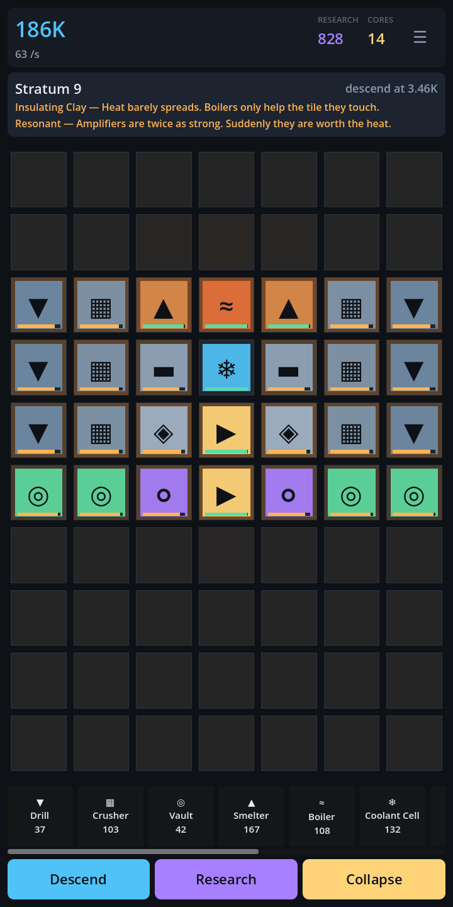

# Lodeworks

**An idle machine-grid builder for Android. Place machines, feed each other by
adjacency, manage heat, descend the strata.**

Not published. This repository is a working game, a test suite that checks the
*balance* and not only the code, and everything needed to put it on Google Play
except the things only a human with a bank account can do.



---

## The loop

A 7×10 grid. Machines have inputs and outputs and feed **whatever is
orthogonally next to them** — there are no belts to draw, because drawing belts
on a phone is miserable. What makes it a puzzle instead of a packing exercise
is heat: every machine emits it, half of it bleeds into each neighbour, and
each machine has a temperature it wants to be at. A Smelter runs 15% faster
with a Boiler beside it. A Press three tiles from that Boiler chokes.

Then:

| timescale | what pulls you back |
|---|---|
| 10 seconds | move one tile, watch the credits-per-second change |
| 1 minute | the first drill → crusher → vault chain pays for the next drill |
| 10 minutes | the quota falls, you descend, the rock is richer and hotter |
| first session | three or four strata, and the first machine that only matters because of what it is next to |
| next day | offline production banked while you were away |
| first week | the component chain, Labs, and the research tree |
| long term | collapse the shaft for Cores, which are the only thing that survives, and start again deeper and faster |

Every stratum is generated from its depth — the same stratum 14 for everybody,
no server involved — with up to two modifiers drawn from a table of twelve.
*Thermal Vent + Brittle Rock* is a different board from *Insulating Clay +
Resonant*, and the layout that was right for one is wrong for the other.

That is the production argument for this design: **one more modifier is one row
of data and a large multiple of gameplay.** A match-3 gets one more level.

## Monetisation, designed in rather than bolted on

- **Rewarded video only. No interstitials, anywhere.** Every ad is opt-in and
  additive: double what you already earned while away, reroll a stratum you
  already reached. Nothing is taken away to be sold back.
- **One IAP.** "Foreman's Licence" — removes ads, +4 hours of offline banking,
  +2 blueprint slots. It unlocks no machine, no stratum, no upgrade. The whole
  game is reachable without it.
- **Neither one can move an economy number**, and that is a test rather than a
  promise: the suite runs the same board licensed and unlicensed and requires
  identical output. If the ad SDK is missing, broken, or hangs mid-ad, the game
  keeps running and the player loses nothing but the ad.
- **No energy, no timers, no gacha, no subscription, no daily-login guilt.**

The revenue cost of skipping interstitials is real and it is on purpose. An
idle game someone keeps on their phone for months is worth more than one they
delete in week one.

## Running it

```bash
godot --path . --resolution 720x1440                              # play it
godot --headless --path . --script res://tests/test_runner.gd     # 97 tests
godot --headless --path . --script res://tools/selftest_cli.gd    # the device self test, minus the device
godot --headless --path . --script res://tools/diagnose.gd        # per-tile balance dump
```

For a phone: the `android` workflow builds an installable APK on every push —
twice, once with the native plugins and once deliberately without them.
[docs/DEVICE-TEST.md](docs/DEVICE-TEST.md) is the procedure for getting it onto
a device and reading the numbers off.

Needs **Godot 4.7.2 or newer** — 4.5 is the floor for Google Play because
anything older targets an SDK Play no longer accepts (see
[docs/RELEASE.md](docs/RELEASE.md)).

## What the tests actually test

`tests/test_progression.gd` is the interesting one. It plays the game headless
at real tick rate and asserts against wall-clock seconds:

- the first quota falls inside a first session
- a well-connected eight-tile board beats a scattered ten-tile one
- heat management pays for itself **when heat is the bottleneck**, and does
  nothing when it is not — which is the lesson the game teaches, so it is
  asserted rather than papered over
- a complete ore → component → research chain fits on the board and runs
- the curve has not walled out by stratum 20

`tests/test_monetization.gd` is the other one worth reading: it asserts that
ads and the purchase cannot touch credits, research or cores, that a bound but
broken ad SDK leaves the game fully playable, that a hand-edited entitlement
file cannot invent a product, and that the analytics vocabulary is exactly the
thirteen events that were decided on and not one more.

Three real balance bugs were found by these and fixed: depth added no yield at
all (`richness` was computed and never applied), the late-game chain deadlocked
because multi-input machines could not be fed on a four-neighbour grid, and the
throughput measurement window was short enough to rank two identical layouts
differently.

## Layout

```
scripts/core/     Grid, Simulation, MachineDB, Strata, Economy — all RefCounted,
                  no nodes, so the whole game runs headless
scripts/sim/      the one autoload that owns live state
scripts/services/ save, analytics, ads, IAP, and the device self test — each
                  degrades to a no-op when its native plugin is absent, so the
                  game always runs and always tests
scripts/ui/       drawn with _draw(); there is not one bitmap in the project
tests/            97 tests, no framework dependency
tools/            screenshots, balance diagnostics, the self test CLI, the
                  plugin installer and the Android build script
.github/          tests and screenshots on every push; the Android export runs
                  there because it is the only place with an Android SDK
store/            listing copy, icon, screenshots generated from the real game
docs/             design and release notes
```

## Honest status

Working: the simulation, the economy, the descent, prestige, the research tree,
saves with offline progress, the tutorial, the UI, and the ad/IAP/analytics
interfaces with their no-op fallbacks.

Not done, stated plainly because the alternative is a plausible number with
nothing behind it:

- **The game has never run on a phone.** Every performance, input, thermal and
  battery figure for real hardware is UNKNOWN. The self test measures all of
  them in one tap; nobody has tapped it.
- **No ad has ever been shown and no purchase has ever been made.** No AdMob
  account, no ad unit ids, no Play Console product. The integration is written
  and its failure paths are tested; the live paths are not, so monetization is
  not working.
- **The Android export has never been executed.** It needs an Android SDK, JDK
  17 and Google's Maven repositories, which the machine this was written on
  cannot reach. The workflow that does it is committed and has never run,
  because the GitHub repository does not exist yet.
- No sound, and blueprints save and load but have no UI.

See [docs/RELEASE.md](docs/RELEASE.md) §6 for claim-by-claim evidence and §7
for what needs a human.

## Licence

Code: MIT (see LICENSE). The name "Lodeworks", the icon and the store copy are
not covered by it.
